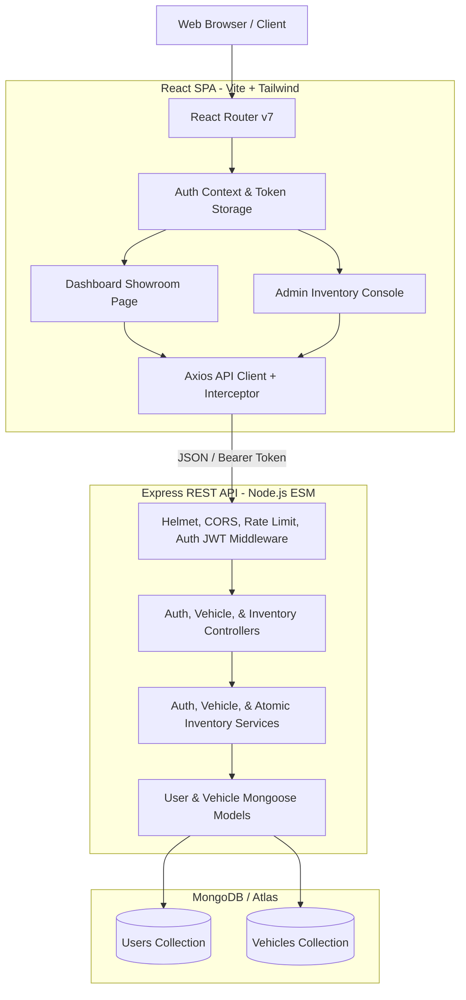

# 🏎️ ApexMotors — Dealership Inventory & Fleet Management System

A production-grade, full-stack vehicle inventory and fleet management platform engineered strictly following **Test-Driven Development (TDD: Red → Green → Refactor)** principles. Built with a decoupled Node.js (ESM) + Express + MongoDB backend and a responsive, high-performance React (Vite) + Tailwind CSS frontend.

---

## 🌟 Executive Overview & Key Features

ApexMotors provides a real-time, concurrency-safe inventory allocation system for luxury and electric vehicles:
- **Catalog Browsing & Multi-Attribute Search:** Real-time search by make and model with regex escaping, filtering by canonical categories (Sedan, SUV, Truck, Coupe, Convertible, Electric, Hybrid, Luxury), price range validation, and sorting (price ascending, price descending, newest).
- **Concurrency-Safe Stock Allocation:** Atomic stock decrement (`$inc: -qty` with conditional `$gte: qty`) preventing inventory overselling during simultaneous purchasing.
- **Stock Status Badges & Indian Rupee (INR) Formatting:** Dynamic visual stock status (`Sold out`, `Only 1 left`, `In stock`) with prices formatted in Indian numbering (`₹1,53,00,000`).
- **Role-Based Access Control (RBAC):** Public registration automatically defaults to `user`. Privileged routes (`POST /api/vehicles`, `PUT /api/vehicles/:id`, `DELETE /api/vehicles/:id`, `POST /api/vehicles/:id/restock`) strictly require `admin` authorization.
- **Dedicated Admin Control Room:** Real-time inventory table, vehicle creation, modal edit forms with field-level validation, restock dialogs, and deletion confirmations.
- **Micro-Interactions & Accessibility:** Glassmorphism headers, shimmer skeleton loaders, accessible modal focus management, and automatic `prefers-reduced-motion` compliance.

---

## 🏗️ Architecture & Technology Stack

### Why These Architectural Choices?
- **Node.js (ESM) & Express:** Native ES module compliance, lightweight runtime, transparent middleware pipeline, and clean separation of concerns.
- **Layered Service Pattern:** Thin controllers handle HTTP mapping; services encapsulate business logic and atomic transactions; models enforce schema-level constraints.
- **MongoDB & Mongoose:** Schema validations, indexed search fields (`make`, `model`, `category`, `price`), and atomic conditional updates without locking overhead.
- **React 19 & Vite 6:** Instant HMR, zero-overhead bundler, route code-splitting with `React.lazy` and `Suspense`, and predictable state management.
- **Tailwind CSS v3:** Custom automotive tokens, curated HSL color palette, accessible contrast ratios, and glassmorphism helpers.
- **Jest + Supertest & Vitest + Testing Library:** High-speed parallel testing with `mongodb-memory-server` in backend and jsdom in frontend.

### Architecture Diagram



---

## 🌐 Live Demo & Reviewer Credentials

- **Live Frontend Application:** `https://car-dealership-inventory-frontend.vercel.app` *(or custom Vercel deployment URL)*
- **Live Backend Health Check:** `https://car-dealership-inventory-backend.vercel.app/api/health`

### Demo Credentials (Pre-seeded for Reviewers)

| Role | Email | Password | Access Rights |
| :--- | :--- | :--- | :--- |
| **Admin** | `admin@dealership.com` | `AdminPass123!` | Full inventory CRUD, restocking, and buyer showroom |
| **Standard User** | `buyer@dealership.com` | `BuyerPass123!` | Browse, multi-filter search, and real-time vehicle purchasing |

---

## 💻 Local Setup & Development Guide

### Prerequisites
- Node.js `>= 18.0.0`
- npm `>= 9.0.0`
- MongoDB local instance running on `localhost:27017` OR MongoDB Atlas connection URI

### 1. Repository Clone
```bash
git clone https://github.com/your-username/CarDealershipInventory_System.git
cd CarDealershipInventory_System
```

### 2. Backend Configuration & Startup
```bash
cd backend

# Install dependencies
npm install

# Setup environment file
cp .env.example .env
# Edit .env if your MongoDB URI differs from mongodb://localhost:27017/cardealership

# Seed initial admin account
npm run seed:admin

# Start development server with live reload
npm run dev
# Backend runs on http://localhost:5000
```

### 3. Frontend Configuration & Startup
```bash
cd ../frontend

# Install dependencies
npm install

# Setup environment file
cp .env.example .env

# Start Vite development server
npm run dev
# Frontend runs on http://localhost:5173
```

---

## 🔌 Complete API Documentation

| Method | Endpoint | Auth Required | Request Body / Query Params | Success Response | Status Codes |
| :--- | :--- | :--- | :--- | :--- | :--- |
| `GET` | `/api/health` | Public | None | `{ status: "ok", timestamp: "..." }` | `200` |
| `POST` | `/api/auth/register` | Public | `{ name, email, password }` | `{ success: true, token, user }` | `201`, `400`, `409` |
| `POST` | `/api/auth/login` | Public | `{ email, password }` | `{ success: true, token, user }` | `200`, `401`, `400` |
| `GET` | `/api/auth/me` | Authenticated | None (`Authorization: Bearer <token>`) | `{ success: true, user }` | `200`, `401` |
| `GET` | `/api/vehicles` | Public | `?page=1&limit=10&includeOutOfStock=false` | `{ success: true, data: [...], total, page, totalPages }` | `200` |
| `GET` | `/api/vehicles/search` | Public | `?search=bmw&category=Sedan&minPrice=10000&maxPrice=100000&sort=price_asc` | `{ success: true, data: [...], total, page, totalPages }` | `200`, `400` |
| `GET` | `/api/vehicles/:id` | Public | None | `{ success: true, data: { vehicle } }` | `200`, `400`, `404` |
| `POST` | `/api/vehicles` | **Admin Only** | `{ make, model, year, category, price, quantity, ... }` | `{ success: true, data: { vehicle } }` | `201`, `400`, `401`, `403` |
| `PUT` | `/api/vehicles/:id` | **Admin Only** | Partial or full vehicle fields | `{ success: true, data: { vehicle } }` | `200`, `400`, `401`, `403`, `404` |
| `DELETE` | `/api/vehicles/:id` | **Admin Only** | None | No content | `204`, `400`, `401`, `403`, `404` |
| `POST` | `/api/vehicles/:id/purchase` | Authenticated | `{ quantity?: number }` (default: 1) | `{ success: true, message, data: { vehicle } }` | `200`, `400`, `401`, `404`, `409` |
| `POST` | `/api/vehicles/:id/restock` | **Admin Only** | `{ quantity: number }` (1 - 10000) | `{ success: true, message, data: { vehicle } }` | `200`, `400`, `401`, `403`, `404` |

---

## 🧪 Comprehensive Test Report & Metrics

Both test suites execute fully isolated in-memory tests without external network or persistent database requirements.

### Backend Test Execution
```bash
cd backend
npm test
npm run test:coverage
```

#### Real Backend Coverage Report (Jest + mongodb-memory-server)
```
--------------------------|---------|----------|---------|---------|-------------------
File                      | % Stmts | % Branch | % Funcs | % Lines | Uncovered Line #s 
--------------------------|---------|----------|---------|---------|-------------------
All files                 |    93.2 |    81.52 |   94.11 |    93.1 |                   
 src                      |   93.33 |       50 |     100 |   93.33 |                   
  app.js                  |   93.33 |       50 |     100 |   93.33 | 29                
 src/config               |   96.42 |       75 |     100 |   96.29 |                   
  db.js                   |     100 |    66.66 |     100 |     100 |                   
  env.js                  |    92.3 |    77.77 |     100 |   91.66 | 24                
 src/constants            |     100 |      100 |     100 |     100 |                   
  vehicleCategories.js    |     100 |      100 |     100 |     100 |                   
 src/controllers          |   94.87 |      100 |    90.9 |   94.87 |                   
  auth.controller.js      |     100 |      100 |     100 |     100 |                   
  inventory.controller.js |     100 |      100 |     100 |     100 |                   
  vehicle.controller.js   |   88.88 |      100 |   83.33 |   88.88 | 32-33             
 src/middleware           |   93.18 |    83.87 |     100 |   92.85 |                   
  asyncHandler.js         |     100 |      100 |     100 |     100 |                   
  auth.js                 |    87.5 |    83.33 |     100 |    87.5 | 23,35,41          
  errorHandler.js         |     100 |    86.66 |     100 |     100 | 6-9               
  notFound.js             |     100 |      100 |     100 |     100 |                   
  validate.js             |     100 |       75 |     100 |     100 | 12                
 src/models               |      96 |       50 |     100 |      96 |                   
  user.model.js           |   93.33 |       50 |     100 |   93.33 | 49                
  vehicle.model.js        |     100 |      100 |     100 |     100 |                   
 src/routes               |   95.65 |      100 |       0 |   95.65 |                   
  auth.routes.js          |    87.5 |      100 |       0 |    87.5 | 49                
  vehicle.routes.js       |     100 |      100 |     100 |     100 |                   
 src/services             |   89.42 |    73.77 |   93.33 |   89.42 |                   
  auth.service.js         |   97.05 |    81.81 |     100 |   97.05 | 74                
  inventory.service.js    |    92.3 |    83.33 |     100 |    92.3 | 31,66             
  vehicle.service.js      |   81.81 |    65.62 |    87.5 |   81.81 | 81-90,101,122     
 src/utils                |   95.55 |    94.82 |     100 |   95.34 |                   
  ApiError.js             |     100 |      100 |     100 |     100 |                   
  queryBuilder.js         |   94.11 |    94.33 |     100 |   93.75 | 54,57             
  token.js                |     100 |      100 |     100 |     100 |                   
--------------------------|---------|----------|---------|---------|-------------------
Test Suites: 15 passed, 15 total
Tests:       86 passed, 86 total
```

---

### Frontend Test Execution
```bash
cd frontend
npm test
npm run test:coverage
```

#### Real Frontend Coverage Report (Vitest + React Testing Library)
```
-------------------|---------|----------|---------|---------|-------------------
File               | % Stmts | % Branch | % Funcs | % Lines | Uncovered Line #s 
-------------------|---------|----------|---------|---------|-------------------
All files          |   83.19 |    70.89 |   53.46 |   83.19 |                   
 frontend/src      |      66 |       50 |   33.33 |      66 |                   
  App.jsx          |   80.48 |      100 |      50 |   80.48 |                   
 frontend/src/api  |   70.63 |    42.85 |    9.09 |   70.63 |                   
 ...mponents/admin |   92.34 |    82.05 |     100 |   92.34 |                   
  VehicleForm.jsx  |   92.34 |    82.05 |     100 |   92.34 |                   
 ...ponents/layout |    64.4 |    63.63 |   33.33 |    64.4 |                   
  Navbar.jsx       |    64.4 |    63.63 |   33.33 |    64.4 |                   
 .../components/ui |   99.13 |     73.8 |     100 |   99.13 |                   
  Badge.jsx        |     100 |    33.33 |     100 |     100 |                   
  Button.jsx       |     100 |    81.81 |     100 |     100 |                   
  Card.jsx         |     100 |       50 |     100 |     100 |                   
  Input.jsx        |     100 |     92.3 |     100 |     100 |                   
  Modal.jsx        |   95.23 |       75 |     100 |   95.23 |                   
  Spinner.jsx      |     100 |       50 |     100 |     100 |                   
  Toast.jsx        |     100 |    33.33 |     100 |     100 |                   
 ...nents/vehicles |     100 |       96 |   58.33 |     100 |                   
  FilterBar.jsx    |     100 |    83.33 |      50 |     100 |                   
  VehicleCard.jsx  |     100 |      100 |      75 |     100 |                   
 ...nd/src/context |   87.34 |    93.33 |   66.66 |   87.34 |                   
  AuthContext.jsx  |   87.34 |    93.33 |   66.66 |   87.34 |                   
 ...tend/src/hooks |   78.69 |    57.14 |    62.5 |   78.69 |                   
  useDebounce.js   |     100 |      100 |     100 |     100 |                   
  useVehicles.js   |     100 |    47.36 |     100 |     100 |                   
 ...tend/src/pages |    85.3 |    63.09 |   51.28 |    85.3 |                   
  AdminPage.jsx    |   84.84 |    57.57 |   39.13 |   84.84 |                   
  ...boardPage.jsx |   74.61 |    69.23 |   28.57 |   74.61 |                   
  LoginPage.jsx    |    97.1 |    78.94 |     100 |    97.1 |                   
  NotFoundPage.jsx |     100 |      100 |     100 |     100 |                   
  RegisterPage.jsx |   87.42 |       50 |     100 |   87.42 |                   
 ...end/src/routes |   68.42 |    69.23 |     100 |   68.42 |                   
  AdminRoute.jsx   |      65 |    57.14 |     100 |      65 |                   
  ...ctedRoute.jsx |   72.22 |    83.33 |     100 |   72.22 |                   
-------------------|---------|----------|---------|---------|-------------------
Test Files  12 passed (12)
Tests       41 passed (41)
```

**Total Combined Tests:** **127 Passed** (86 Backend + 41 Frontend, 0 Failed, 0 Skipped).

---

## 🔄 Test-Driven Development (TDD) Methodology

The application was built following the strict TDD cycle:
1. **Red:** Write an expressive, failing test suite defining unit contracts or user workflows.
2. **Green:** Implement the minimal production code necessary to satisfy test assertions.
3. **Refactor:** Clean code structure, eliminate redundancy, and enforce architectural boundaries while keeping the suite green.

### Key Commit Milestones Demonstrating TDD Red-Green Pairs

| Milestone | Failing Test Commit (Red) | Passing Implementation Commit (Green) | Key Capability Implemented |
| :--- | :--- | :--- | :--- |
| **Inventory & Concurrency** | `58fe98f` | `af33a94` | Atomic `$inc` conditional purchase, 10 parallel requests test |
| **UI Design System** | `de86bc1` | `29b7677` | Button, Input, Modal, Toast, Badge, and Card components |
| **Auth Context & Session** | `7d1b3b6` | `155049a` | Token persistence, session restore on mount, Axios interceptor |
| **Route Protection & RBAC**| `243acf1` | `ae49b21` | `ProtectedRoute` and `AdminRoute` redirect guards |
| **Auth Pages (Login/Reg)** | `17419b8` | `92ae6ad` | Split layout, client validation, credential submission |
| **Vehicle Card (INR)** | `efbbbad` | `618b438` | Indian numbering system price formatting, stock status badges |
| **Debounce Search** | `b37ee33` | `9c3a1f4` | Custom `useDebounce` hook with fake timers |
| **Filter & Sorting Bar** | `0aa27bb` | `ddf3461` | Multi-field search, category pill filter, price inputs |
| **Dashboard Catalog** | `51e5dd9` | `f347853` | Skeleton shimmer loading, catalog grid, purchase toasts |
| **Admin Vehicle Form** | `63f65a9` | `8da8e11` | Modal form pre-filling, input constraints, number parsing |
| **Admin Console Page** | `693f0e8` | `dcd1351` | Inventory table, restock dialog, delete confirmation |

---

## 📸 Screenshots

*(Capture actual screenshots of the running application and place in `docs/screenshots/`)*

| View | Screenshot Preview |
| :--- | :--- |
| **Auth / Login** |  |
| **Dealership Catalog** |  |
| **Filtered Search** |  |
| **Sold Out Indicators** |  |
| **Admin Inventory Panel** |  |
| **Responsive Mobile Layout** |  |

---

## 🤖 My AI Usage

<!--
NOTE TO AUTHOR: This section must be completed by you in accordance with submission guidelines.
Cover the tools used, your specific workflows, and your honest reflection on the productivity impact.
-->

### 1. Tools Used
*(e.g., Antigravity IDE, Claude, Gemini Flash, GitHub Copilot, ChatGPT)*

### 2. Workflow & How I Used AI
*(Detail how AI was utilized for test generation, scaffold generation, refactoring, and code explanation)*

### 3. Reflections & Impact
*(Reflect honestly on the strengths, acceleration factors, edge cases caught by tests, and lessons learned)*

---

## 📂 Project Directory Structure

```
CarDealershipInventory_System/
├── backend/
│   ├── api/
│   │   └── index.js                   # Vercel serverless function entrypoint
│   ├── scripts/
│   │   └── seed-admin.js              # Idempotent admin account seeder
│   ├── src/
│   │   ├── config/                    # Environment & cached DB connection
│   │   ├── constants/                 # Canonical vehicle categories
│   │   ├── controllers/               # Thin HTTP handlers (Auth, Vehicle, Inventory)
│   │   ├── middleware/                # JWT auth, RBAC, error handlers, validator
│   │   ├── models/                    # Mongoose schemas (User, Vehicle)
│   │   ├── routes/                    # Express REST route endpoints
│   │   ├── services/                  # Business logic & atomic database operations
│   │   ├── utils/                     # ApiError, token utils, query builder
│   │   ├── app.js                     # Express app configuration
│   │   └── server.js                  # Local dev HTTP server entrypoint
│   ├── tests/
│   │   ├── integration/               # Integration test suites with in-memory Mongo
│   │   ├── setup/                     # mongodb-memory-server connection runner
│   │   └── unit/                      # Unit tests for models, services, and utils
│   ├── package.json
│   └── vercel.json                    # Serverless route rewrites
├── frontend/
│   ├── public/
│   │   └── favicon.svg                # ApexMotors lightning automotive brand icon
│   ├── src/
│   │   ├── api/                       # Axios client & typed REST endpoint helpers
│   │   ├── components/
│   │   │   ├── admin/                 # Admin VehicleForm modal
│   │   │   ├── layout/                # Navbar & brand headers
│   │   │   ├── ui/                    # Design system (Button, Input, Modal, Badge, Toast, Card, Spinner)
│   │   │   └── vehicles/              # VehicleCard, FilterBar
│   │   ├── context/                   # AuthContext & persistent state
│   │   ├── hooks/                     # useDebounce, useVehicles, useVehicleMutations
│   │   ├── pages/                     # LoginPage, RegisterPage, DashboardPage, AdminPage, NotFoundPage
│   │   ├── routes/                    # ProtectedRoute, AdminRoute guards
│   │   ├── test/                      # Vitest component & page integration test suites
│   │   ├── App.jsx                    # Lazy-loaded router with Suspense boundary
│   │   ├── index.css                  # Tailwind styles, glassmorphism, shimmer, reduced motion
│   │   └── main.jsx
│   ├── index.html                     # SEO metadata, Google Fonts, Open Graph tags
│   ├── package.json
│   ├── tailwind.config.js             # Automotive tokens, brand colors, drop shadows
│   └── vercel.json                    # SPA single-page routing rewrite
├── docs/
│   └── screenshots/                   # Application capture images
├── prompts/                           # Mirrored prompt files 00 - 10
├── .gitignore
├── PROMPTS.md                         # Raw AI conversation log repository
└── README.md                          # Project documentation
```

---

## 🚀 Vercel Deployment Instructions

### 1. MongoDB Atlas Setup
1. Log in to [MongoDB Atlas](https://cloud.mongodb.com) and create a free tier **M0 cluster**.
2. Under **Database Access**, create a user (e.g., `dealership_admin`) with a secure password.
3. Under **Network Access**, add `0.0.0.0/0` (Allow Access from Anywhere) to permit Vercel's dynamic serverless IP pool. *(Note: Ensure a strong password is used on the database user).*
4. Retrieve the standard connection string: `mongodb+srv://<username>:<password>@cluster0.mongodb.net/cardealership?retryWrites=true&w=majority`.
5. Run the admin seeder once against production from your local machine:
   ```bash
   MONGODB_URI="your-atlas-uri" ADMIN_EMAIL="admin@dealership.com" ADMIN_PASSWORD="YourPassword123!" npm run seed:admin
   ```

### 2. Backend Deployment on Vercel
1. In the Vercel Dashboard, import the repository and set the **Root Directory** to `backend`.
2. Framework Preset: **Other**.
3. Add the following Environment Variables in Vercel:
   - `MONGODB_URI`: Your MongoDB Atlas connection URI
   - `JWT_SECRET`: A secure 64-character random string
   - `JWT_EXPIRES_IN`: `7d`
   - `FRONTEND_URL`: `http://localhost:5173` *(update to actual frontend Vercel URL once deployed)*
   - `NODE_ENV`: `production`
4. Click **Deploy**. Note the assigned URL: `https://your-backend.vercel.app`. Verify that visiting `https://your-backend.vercel.app/api/health` returns `{ "status": "ok" }`.

### 3. Frontend Deployment on Vercel
1. In the Vercel Dashboard, import the same repository again and set the **Root Directory** to `frontend`.
2. Framework Preset: **Vite**.
3. Add the following Environment Variable:
   - `VITE_API_URL`: `https://your-backend.vercel.app/api`
4. Click **Deploy**.
5. Once the frontend deployment URL is ready (`https://your-frontend.vercel.app`), return to the Backend Vercel project settings and update `FRONTEND_URL` to match, then trigger a redeploy of the backend.

---

## 🔍 Post-Deploy Smoke Test & Troubleshooting

### Smoke Test Flow
1. **Registration:** Create a new user account with a valid email and 8+ character password.
2. **Login & Session:** Confirm token persistence and redirect to the Showroom.
3. **Showroom Search:** Filter by category, test price range, and search by make/model.
4. **Purchase:** Click Purchase on an in-stock vehicle; observe instant stock decrement, badge update, and success toast.
5. **Sign Out:** Sign out from the top right navigation.
6. **Admin Login:** Log in using `admin@dealership.com` / `AdminPass123!`.
7. **Admin Operations:** Access the Admin Panel, create a new vehicle, edit its details, restock units, and delete a test vehicle.

### Common Troubleshooting
- **CORS Blocked:** Ensure `FRONTEND_URL` in the backend environment matches the exact frontend domain including `https://` without a trailing slash.
- **Deep Link 404 on Refresh:** Verify `frontend/vercel.json` contains the SPA rewrite to `/index.html`.
- **Database Connection Timeout:** Verify Network Access `0.0.0.0/0` is active on MongoDB Atlas.
